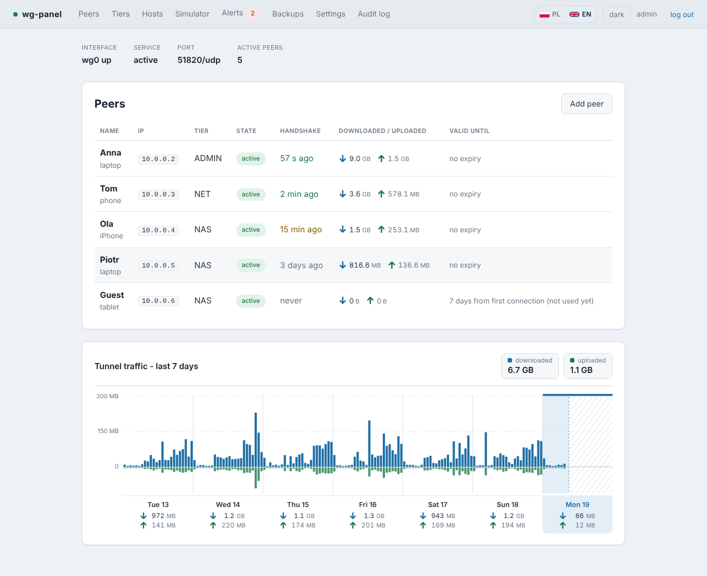
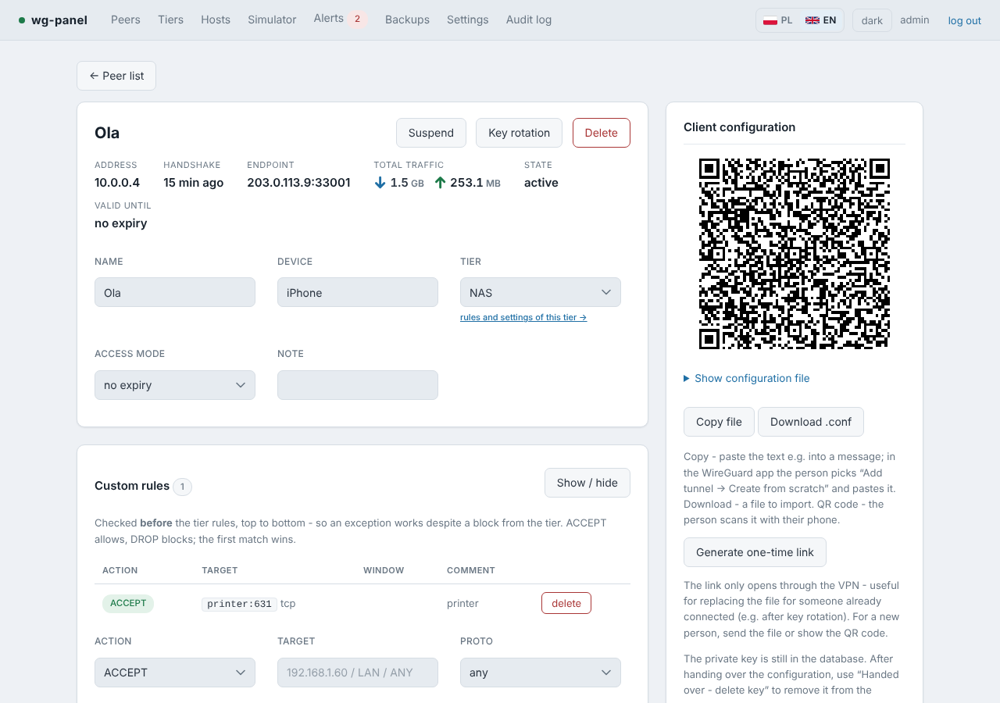
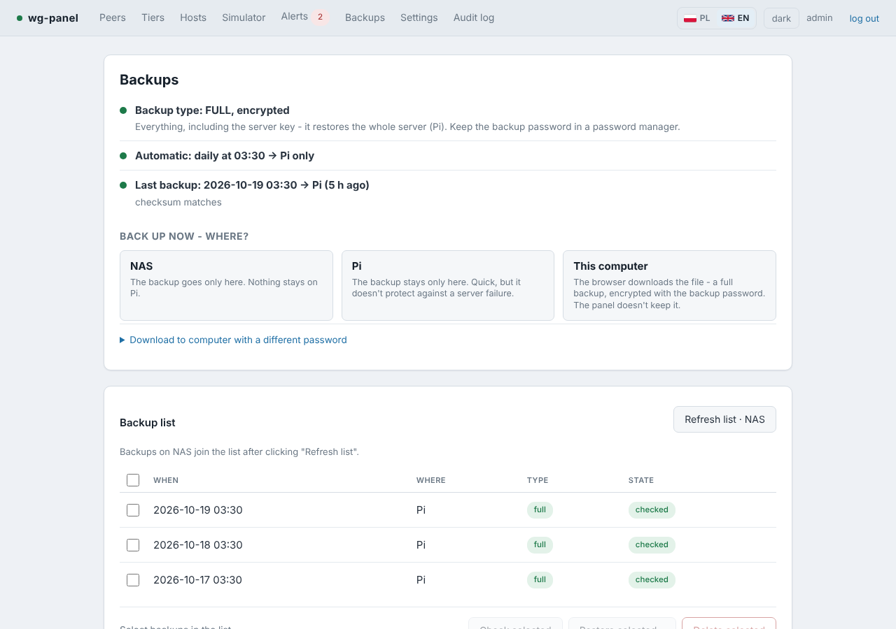
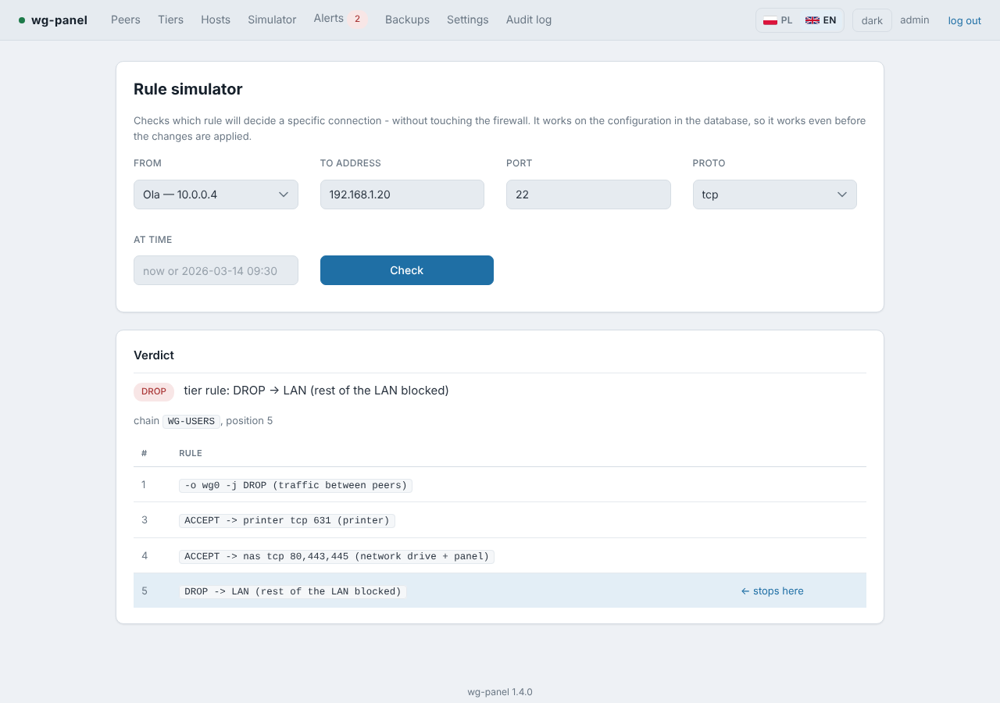
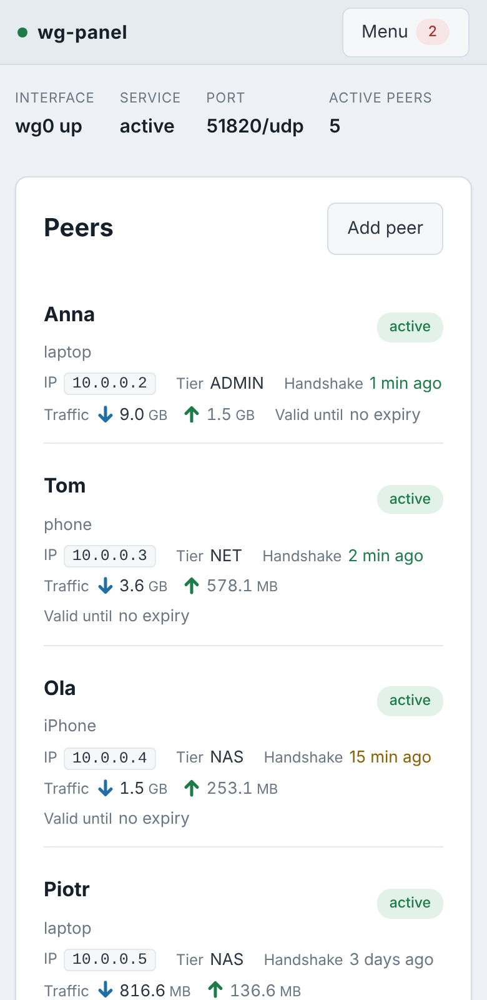

# wg-panel

**A web panel and CLI for a home WireGuard server on a Raspberry Pi, built around access rules rather than keys.**

[Polski / Polish version](README.pl.md)

Most WireGuard UIs manage peers: a key and an address. wg-panel manages what each person can
reach in your home network. Every peer belongs to a tier (for example "only the NAS on ports
80/443/445"), can have its own exceptions, and can have an access window. The panel turns all
of that into `wg0.conf` and iptables rules, shows you the difference before applying it, and
undoes the change automatically if it cut you off.

- Pure Python 3.9+ standard library. No pip packages, no Node, no build step, no CDN.
- Uses the `wg` and `iptables` tools that are already on the Pi. QR codes are generated in pure Python.
- The web process never runs as root. A small helper does, and accepts only a fixed list of operations.
- Polish and English interface, dark and light theme, works on a phone.



<table>
  <tr>
    <td></td>
    <td></td>
  </tr>
  <tr>
    <td></td>
    <td align="center"></td>
  </tr>
</table>

## Features

| | |
|---|---|
| **Tiers** | Named rule sets. Change a tier and everyone in it changes at once. Three are created on first install: ADMIN (everything), NET (internet only, LAN blocked), NAS (only the NAS). |
| **Per-peer rules** | Host, port, range, time window, ACCEPT or DROP. Checked before the tier rules, so an exception works despite a tier-wide block. |
| **Access to the Pi itself** | A separate chain on `INPUT`, so SSH or RDP to the Pi is only open to the peers you choose. |
| **Access windows** | No expiry, a fixed window (from–to), or N days from the first connection, which suits guests who get a QR code today and use it next week. |
| **Host catalogue** | Write `nas` or `printer` in rules instead of IP addresses; change the address in one place. |
| **What goes through the VPN** | `AllowedIPs` in each client file is computed from what the person can actually reach (full tunnel or split tunnel). |
| **Safe apply** | You see a diff before applying. If the change isn't confirmed within 90 s, it rolls back by itself. The browser confirms automatically when it can still reach the panel. |
| **Rule simulator** | "Will this peer reach this host on this port, and which rule decides?" Works before you apply. |
| **Alerts** | Same key from a new IP address, the same file used on two devices at once, a silent peer, expiry, a failed backup, a configuration changed outside the panel. Sent via ntfy, webhook or e-mail. |
| **Guard** | A systemd timer outside the panel process checks the panel, the helper, `wg0`, temperature, disk space, undervoltage and the certificate, and enforces access expiry even when the panel is down. |
| **Integrity check** | Detects hand edits to `wg0.conf`, rules added to the panel's chains, keys added with `wg set`, and rules inserted in front of the panel's chain. |
| **Backups** | Daily, to a NAS (SMB share), to the Pi, or downloaded to your computer. A full backup is encrypted and contains the server key, so you can rebuild the whole Pi from it with one command. |
| **HTTPS** | The panel's own certificate authority, limited by X.509 name constraints to your home network, the VPN and the Pi's name. Your own certificate (for example Let's Encrypt) also works. |
| **Your own device names** | "Pi" and "NAS" are labels you can rename (Backups → Rename); the new name shows up everywhere, including alerts, and travels with the backup. |
| **Traffic history** | Hourly chart for 7 days — one column per day with daily totals, today highlighted — total and per peer, with anomaly detection. The peer list shows ↓ downloaded / ↑ uploaded the same way, so the numbers match the chart. |
| **IPv6** | Optional. Rules apply to both address families. |
| **One-time links, key deletion** | Hand over a configuration without sending the file around, then delete the private key from the server. |
| **`wgctl`** | Everything the panel does, from the terminal. Same database, same helper. |
| **Audit log** | Who changed what and when. The log and the alerts each have their own retention (90 days by default, 0 = keep everything). |

## Requirements

- Raspberry Pi OS or Debian 12 (another Debian-based system with systemd should work too).
- Python 3.9 or newer (already on Raspberry Pi OS).
- Root access. The installer adds `wireguard-tools`, `iptables` and `smbclient` if they are missing.
- A UDP port forwarded from your router to the Pi (51820 by default) and a public address or DDNS name.
- `ufw` is optional. When present, the installer adds a rule that opens the panel's port only on `wg0` (and on your LAN if you ask for it).

## Quick start

Copy the project to the Pi and run the installer:

```bash
git clone https://github.com/mt3ch02/wg-panel.git
cd wg-panel
sudo ./install.sh
```

The panel is reachable from your home network out of the box (`LAN_ACCESS=auto` is the default): the
installer takes the network the server is in and opens the panel port to it only. You can also give one,
e.g. `LAN_ACCESS=192.168.1.0/24`. A saved network that doesn't match the server any more
(a backup restored on another computer, a new router) switches to the server's own network by itself.
An update keeps your earlier choice: a panel set up for the VPN only stays that way until you run `sudo LAN_ACCESS=auto ./install.sh`.
With `LAN_ACCESS=off` the panel listens only on the VPN address `10.0.0.1` and on the Pi itself
(reach it with `ssh -L 8080:127.0.0.1:8080 pi@<pi-address>` and then `http://localhost:8080`).

A step-by-step guide covering all three cases — taking over an existing WireGuard, a clean install and a
restore onto a new Pi — is in [docs/en/INSTALL.md](docs/en/INSTALL.md).

What the installer does on a clean system:

1. Asks about the server key: paste an existing one, or generate a new one.
2. Detects your home network, the Pi's LAN address and the WAN interface, and suggests the NAS address.
3. Creates the `wg-panel` service account, the services and the certificate authority, and adds your account to the `wg-panel` group so `wgctl` works without `sudo`.
4. Prints the panel address, the certificate fingerprint and the next steps.

Then:

1. Open `https://<pi-address>:8080` and create the administrator account (password of at least 10 characters).
   The browser will warn about the certificate until you install the panel's CA. The `/tls` page has the file and instructions for iPhone, Android, Windows and macOS.
2. Switch to English with the **PL / EN** switch next to the theme button.
3. In **Settings**, set **Client endpoint** to your DDNS name or public IP with the port (for example `vpn.example.org:51820`) and check the detected addresses.
4. In **Hosts**, check the address suggested for `nas`. The NAS tier uses it.
5. Add people in **Peers**, then **Apply changes**. The first apply brings the tunnel up.
6. Put yourself in the ADMIN tier. Over the VPN, the panel opens only for tiers that list its port under **Ports on the server itself**, and by default that's only ADMIN (`22,3389,8080`).

## Updating

Get the new version and run the installer again:

```bash
cd wg-panel
git pull
sudo ./install.sh
```

The installer prints the change (`Updating wg-panel: 1.3.2 -> 1.4.0`). The installed version is
shown at the bottom of every page and by `wgctl --version`; what changed is in
[CHANGELOG.md](CHANGELOG.md).

An update replaces only the program. Everything you set up stays:

- **Your data** (peers, tiers, rules, hosts, accounts, settings, history) lives in `/var/lib/wg-panel/panel.db`, separate from the code in `/opt/wg-panel`. New settings are added with their defaults; your values are never overwritten.
- **Install options** (`LAN_ACCESS`, `BIND_PORT`, `TLS`, `INSTALL_LANG`) are remembered in `/etc/wg-panel/install.conf`. You don't repeat them. To change one, pass it again; `LAN_ACCESS=off` (or an empty `LAN_ACCESS=`) turns LAN access off. Installs made before this file existed read the options from the installed service and the ufw rule.
- **A snapshot of the database** is taken before the new code starts. It appears in **Backups** as "before update" and can be restored like any other backup.
- **Built-in tiers and the `nas` host** are created only on the very first install. If you renamed or deleted them, an update doesn't bring them back.
- **The server key, certificates and client files** are not touched. Nobody needs a new file.

If the peer list shows "The panel has changes that are not on the interface" after an update,
click **Apply changes**. That happens when a new version generates the files slightly differently.

## Taking over an existing WireGuard

If `/etc/wireguard/wg0.conf` already exists and wasn't made by the panel, the installer treats
it as a takeover:

1. It saves the current state (`wg0.conf`, `iptables-save`, `ufw status`) to `/root/wg-panel-before/`. That is your way back (`uninstall.sh --restore`).
2. It installs the panel without touching the running tunnel.
3. You import the peers, first as a dry run:

```bash
cd /opt/wg-panel
sudo cat /etc/wireguard/wg0.conf | sudo -u wg-panel \
     WGPANEL_DB=/var/lib/wg-panel/panel.db python3 -m panel.import_conf - --tier NAS --dry-run
# looks right? run it again without --dry-run
```

4. In the panel, give people names and tiers, check them in the **Simulator**, look at the diff and **Apply changes**.

The first apply overwrites `wg0.conf` with the generated version. Imported peers keep working
with their existing files. The panel doesn't have their private keys (`wg0.conf` never contains
them), so to issue a new file for someone you do a **key rotation**.

## Restoring onto a new Pi

With a **full** backup, a clean system becomes the old Pi with one command:

```bash
sudo ./install.sh --restore                 # backup on your NAS
sudo ./install.sh --restore ~/backup.json.enc   # or a backup file (USB stick, your computer)
```

The installer asks for the NAS share (unless you give a file) and the backup password, checks the
checksum, restores the server key, the certificate authority, the database and the install options
(LAN access, port, HTTPS, language), and brings the tunnel up. Everyone keeps connecting with their
existing files, and devices keep trusting the panel's certificate. Before it changes anything it
warns when the new Pi has a different name or address than the old one.

Check now and then that your backup password still opens the backup — nothing is changed:

```bash
sudo ./install.sh --restore --check
```

### Trying a restore on a second machine (test server)

To see that a restore really works without touching the running server, restore onto a spare
machine (another Pi, a virtual machine) in test mode:

```bash
sudo ./install.sh --restore --test              # or: --restore --test ~/backup.json.enc
```

It is a normal restore, but the copy behaves like a test server: automatic backups and
notifications are off (so it doesn't overwrite the real backups on the NAS or send alerts),
people's files, QR codes and one-time links are not issued (the copy has the same server key, so a
device using a file from it would fight with the real server), every page shows a red **Test
server** bar and the server name gets "(test)". A manual backup asks for confirmation first.

When you're done, uninstall it, or — if this machine is to become the real server — click
**This is now the real server** on the red bar (or run `wgctl test off`). `wgctl test status`
shows the mode.

From a basic backup (no server key), the installer asks whether to paste the old key or generate
a new one. With a new key, everyone needs a new file.

## Install options

Pass them as environment variables on the first install. Updates reuse the saved values.

| Option | Default | Meaning |
|---|---|---|
| `LAN_ACCESS` | `auto` | Network allowed to open the panel besides the VPN: `auto` (the server's own network), e.g. `192.168.1.0/24`, or `off` (VPN and SSH tunnel only). |
| `BIND_PORT` | `8080` | Panel port (HTTPS and HTTP on the same port; plain HTTP from the network is redirected). |
| `TLS` | `1` | `0` turns HTTPS off. |
| `INSTALL_LANG` | `en` | `pl` for Polish installer messages. |
| `SERVER_KEY` | ask | `paste` (key on standard input) or `new`, for installs without a terminal. |

## Backups

The **Backups** page has three parts: the current state, **Back up now – where?**
(NAS / this Pi / this computer) and one list of all backups with actions on the selected
ones (check checksum, restore, delete). Settings are at the bottom.

| | Basic (no backup password) | Full (with a password, encrypted) |
|---|---|---|
| Settings, tiers, peers, rules, hosts, accounts | ✓ | ✓ |
| Passwords for the NAS, ntfy and e-mail | | ✓ |
| History: traffic, handshakes, audit log, alerts | | ✓ |
| Server private key and HTTPS certificate authority | | ✓ |

- **Where a backup goes** is your choice: NAS only (the file exists on the Pi only while it's being sent), the Pi only, or both.
- **Checksums.** Every backup gets a SHA-256 stored in the database and in a `.sha256` file. Right after saving, the panel downloads the backup from where it actually lives and checks it; each daily backup also re-checks the three previous ones.
- **Encryption:** scrypt → ChaCha20 (RFC 8439) + HMAC-SHA256, implemented in the standard library and tested against the RFC vectors. Keep the backup password in a password manager.
- **The NAS isn't polled in the background.** The list asks the NAS only when you click **Refresh list · NAS**, so a sleeping NAS stays asleep.
- A basic backup contains the pre-shared keys of all peers in plain text. The panel shows a red dot when that is the case.

## Security model

```
browser                 wgctl (terminal)
   |  HTTPS (wg0, LAN)      |
   v                        v
   +---- SQLite: source of truth ----+
                  |
                  |  unix socket, JSON, fixed list of operations
                  v
       helper/wg_panel_helper.py   (root)
                  |
                  v
  /etc/wireguard/wg0.conf  +  WG-USERS / WG-USERS-HOST chains
```

- **The panel never sends commands or ready-made file contents.** It sends a data model. The helper validates it again and renders the files itself, so a compromised web process can't make the helper do anything it wasn't written to do.
- **The server private key never enters the database or the panel.** The helper reads it from disk when rendering.
- **Never expose the panel to the internet.** It listens on the VPN address (and your LAN if you choose). From the VPN, only tiers that list the panel's port under **Ports on the server itself** can open it.
- **No independent security audit.** The design is defence in depth, but nobody outside the project has reviewed it. Keep the panel off the internet and take the snapshots the guide asks for.
- Logins are rate-limited (5 attempts per 5 minutes per address). Passwords use scrypt, and TOTP is optional. Every POST carries a CSRF token. Cookies are HttpOnly and SameSite=Strict, and the systemd units are hardened.

See [SECURITY.md](SECURITY.md) for reporting vulnerabilities.

## Command line

```bash
wgctl status                                   # tunnel state, unapplied changes
wgctl list                                     # peers with handshake and expiry
wgctl add Anna --tier NAS --device laptop
wgctl add Guest --tier NET --days 7            # 7 days from the first connection
wgctl qr Anna                                  # QR code in the terminal
wgctl rule add Anna --accept printer --proto tcp --port 631
wgctl check Anna 192.168.1.10 445 -v           # simulate, exit code 0 = ACCEPT, 2 = DROP
wgctl diff && wgctl apply                      # then: wgctl confirm
wgctl backup --target smb                      # smb / local / both
wgctl --version                                # installed version
```

`wgctl --help` lists everything.

## Uninstalling

```bash
sudo /opt/wg-panel/uninstall.sh            # removes the panel; the VPN keeps running, data stays
sudo /opt/wg-panel/uninstall.sh --purge    # also removes data, the service account and saved options
sudo /opt/wg-panel/uninstall.sh --restore  # --purge and back to the pre-panel configuration
sudo /opt/wg-panel/uninstall.sh --wireguard  # --purge and all of WireGuard (tunnels, server key, packages)
```

Without an option the script asks which level you want. Only `--wireguard` touches the server key and the
`wg-quick@wg0` service — it asks for a separate phrase (`remove wireguard`). Backups on the NAS are never touched.

## Languages and known limitations

- The web interface is fully Polish and English. The choice is per browser.
- Push and e-mail notification text and `wgctl` output are in Polish. The documentation is in English and Polish.
- Designed for one WireGuard interface (`wg0`) on one Pi, for a household or a small office.

## Development

There is no build step. Each test file sets up its own temporary database and replaces `wg`,
`iptables` and `systemctl` with stubs, so the tests don't touch the network:

```bash
for t in tests/selftest.py tests/test_*.py; do python3 "$t" || break; done
```

`tests/test_permissions.py` needs root (it switches to other user IDs) and skips itself otherwise.
How the panel works inside (rule order, the safe apply, integrity checks, HTTPS, backups, every
module) is described in [docs/en/ARCHITECTURE.md](docs/en/ARCHITECTURE.md) ([po polsku](docs/pl/ARCHITEKTURA.md)).

```
panel/        web application (HTTP server, views, rules, backups, scheduler)
helper/       the only component running as root
wgctl         command-line interface
systemd/      service units and the guard timer
install.sh    install, update and --restore
uninstall.sh  four levels of removal
tests/        tests (not installed on the Pi)
docs/         install guides and technical documentation (en, pl), screenshots
```

## License

[MIT](LICENSE)
