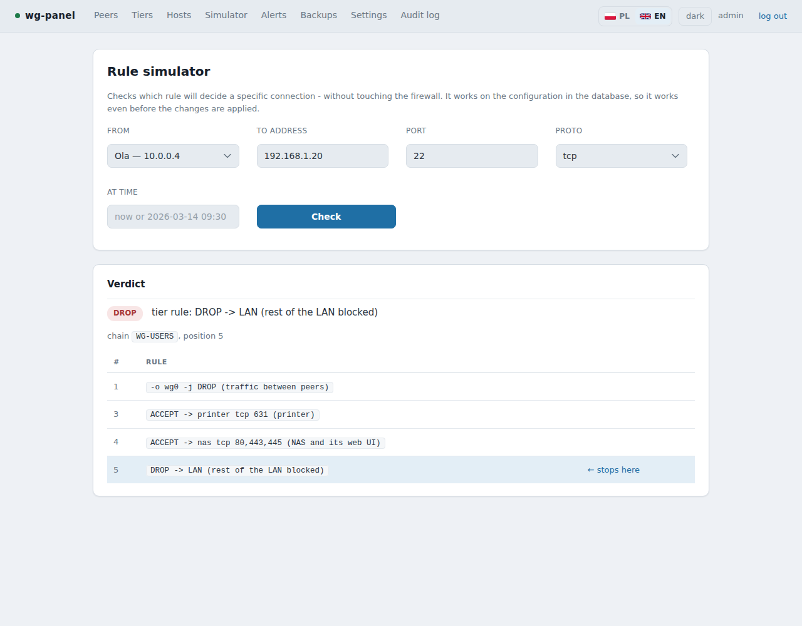
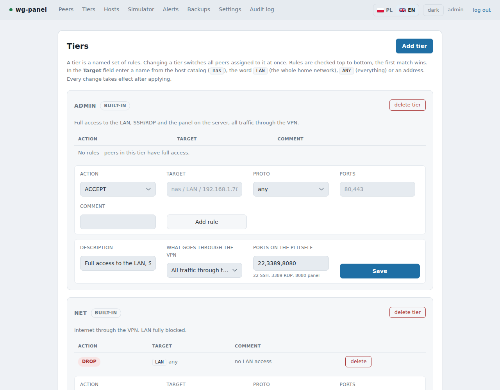

# wg-panel

**[Polski → README.pl.md](README.pl.md)**

A web panel **and CLI** for WireGuard where **access policy is a first-class citizen**. Most WireGuard panels model a peer: a key and an address. Here the peer is only a carrier — what matters is what it can reach on your LAN, and that is a set of iptables rules generated together with the configuration.

Built for a home or small-office setup on a Raspberry Pi: a handful of people, one NAS, a few devices, and you want "Marek may open the NAS and nothing else" to actually be true — and provable.


- **No pip dependencies.** Plain Python 3.9+ standard library.
- **No build step.** No Node, no bundler, no CDNs.
- Uses `wg` and `iptables`, which are already on the machine. Draws QR codes itself, in pure Python.
- Panel in **English and Polish** (follows your browser's language, switchable); installer in both too.

> ⚠ **Read before you use it.** wg-panel writes your firewall rules and `wg0.conf`, and part of it runs as root. It has a defence-in-depth design (see [Security](#security)), but it has **not had an independent security audit**. Keep it off the public internet, follow the [install guide](docs/en/INSTALL.md), and take the snapshots it asks for.

## Features

| | |
|---|---|
| **Tiers** | a named rule set; changing a tier switches everyone assigned to it at once |
| **Per-peer rules** | host, port, range, time window (`-m time`), ACCEPT/DROP; checked before the tier's rules |
| **Rule simulator** | "can this peer reach that host on that port, and which rule decides?" — before you apply anything |
| **Safety fuse** | apply with an automatic rollback if you don't confirm — a rule that cuts you off heals itself |
| **Diff preview** | see what will change before applying |
| **Access windows** | unlimited, a from–to window, or N days from first use; works even when the panel is down |
| **Host catalog** | `nas`, `printer` instead of addresses in rules; change an IP in one place |
| **Split tunnel or full** | per tier or per person: all traffic, only what they can reach, whole LAN, or a custom list |
| **Server access control** | SSH/RDP to the Pi only for chosen peers, in a separate chain |
| **Backups** | daily, local or to a NAS over SMB; SHA-256 checksums verified by re-downloading; optional ChaCha20 + HMAC encryption |
| **Alerts** | new address for a known key (leaked config?), the same file used on two devices at once (the cause of "the VPN keeps dropping"), silent peer, expiry, failed backup — via ntfy, webhook or e-mail |
| **Watchdog** | independent systemd timer: panel, helper, `wg0`, Pi temperature, power, disk, certificate |
| **Integrity check** | detects config changes made outside the panel |
| **Traffic history** | 7-day chart and anomaly detection |
| **HTTPS** | own name-constrained CA (or your certificate); reverse-proxy friendly |
| **One-time links, key wipe** | hand out a config without keeping the private key on the server |
| **IPv6** | optional; rules generated for both families |
| **Phone-friendly** | usable from 320 px; dark theme by default |
| **`wgctl`** | everything the panel does, from a terminal |

<p>


</p>

## Requirements

- Raspberry Pi OS / Debian / Ubuntu with **systemd**, root access
- `wireguard` (`wg`, `wg-quick`), `iptables`, Python **3.9+**, `openssl`
- optional: `smbclient` (backups to a NAS — the installer offers to install it), `ufw`
- The Pi should sit behind a router with a **DHCP reservation** and the WireGuard UDP port forwarded

## Quick start

```bash
sudo apt install -y git
git clone https://github.com/mt3ch02/wg-panel.git
cd wg-panel
sudo ./install.sh                      # add INSTALL_LANG=pl for Polish installer messages
```

Then open the panel, create an account, and **check the network settings** (LAN subnet, Pi address, NAS address, endpoint) — the defaults assume a typical home network (`192.168.1.0/24`). The [install guide](docs/en/INSTALL.md) covers three paths:

| You have | Path |
|---|---|
| a WireGuard server already running on the Pi | **A** — the panel takes it over; clients change nothing |
| a clean system | **B** — new server key, new VPN |
| a clean system and a panel backup + your server key | **C** — restore; nobody changes anything |

Installer options: `LAN_ACCESS=192.168.1.0/24` (open the panel to your home network), `BIND_HOST`, `BIND_PORT`, `TLS=0`, `INSTALL_LANG=pl`. Update with `git pull && sudo ./install.sh` — your data stays. Remove with `sudo /opt/wg-panel/uninstall.sh` (the VPN keeps running).

## How it works

```
browser            wgctl (terminal)
   |                    |
   v                    v
   +--- SQLite: source of truth ---+
                |   unix socket, allow-list of operations
                v
      helper (root)  ->  wg0.conf + WG-USERS / WG-USERS-HOST chains
```

The web process has no root. It never sends commands — only a data model — and the small helper validates it again and renders the files itself. The server's private key never enters the database. The VPN keeps working if the panel is down. Details: [docs/en/ARCHITECTURE.md](docs/en/ARCHITECTURE.md).

## Security

Process separation, an allow-list helper, validation on both sides, no shell anywhere, scrypt + login lockout + optional TOTP, CSRF tokens, `HttpOnly`/`SameSite=Strict` cookies, systemd hardening, encrypted backups, and an alert when a key shows up from a new address. The full table and what the panel does **not** protect against (root on the Pi, a stolen SD card) is in the architecture doc. To report a vulnerability, see [SECURITY.md](SECURITY.md).


## Known limitations

- Defaults assume a typical home network (LAN `192.168.1.0/24`, NAS `192.168.1.11`, Pi `192.168.1.10`, WireGuard port `51820`). Check them in Settings before the first apply.
- `wgctl`, notification text and code comments are currently **in Polish**. The panel and installer are bilingual. Translations and PRs welcome.
- Tested on Raspberry Pi OS (Debian) only.

## Documentation

| | English | Polski |
|---|---|---|
| Install & operate | [docs/en/INSTALL.md](docs/en/INSTALL.md) | [docs/pl/INSTALACJA.md](docs/pl/INSTALACJA.md) |
| Architecture | [docs/en/ARCHITECTURE.md](docs/en/ARCHITECTURE.md) | [docs/pl/ARCHITEKTURA.md](docs/pl/ARCHITEKTURA.md) |

## License

[MIT](LICENSE)
