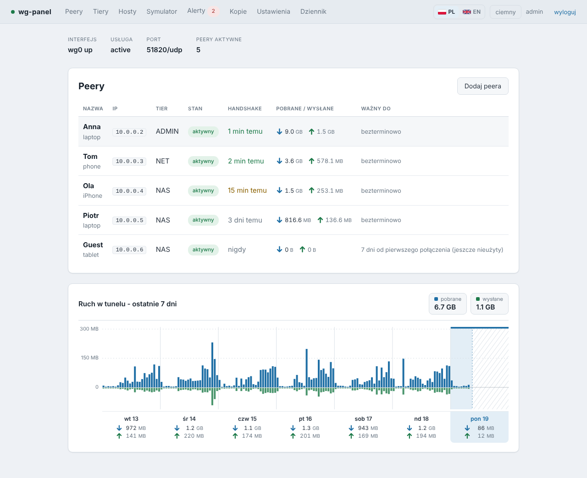
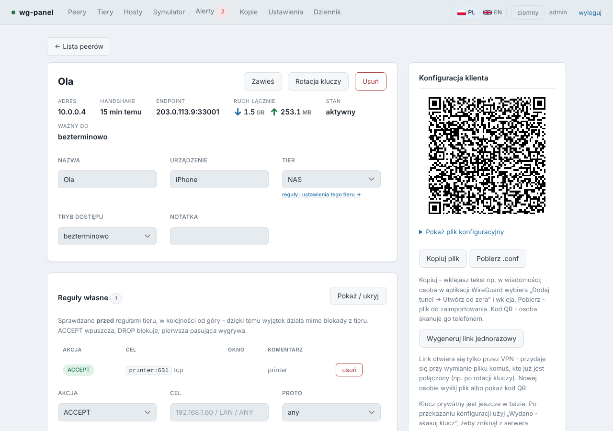
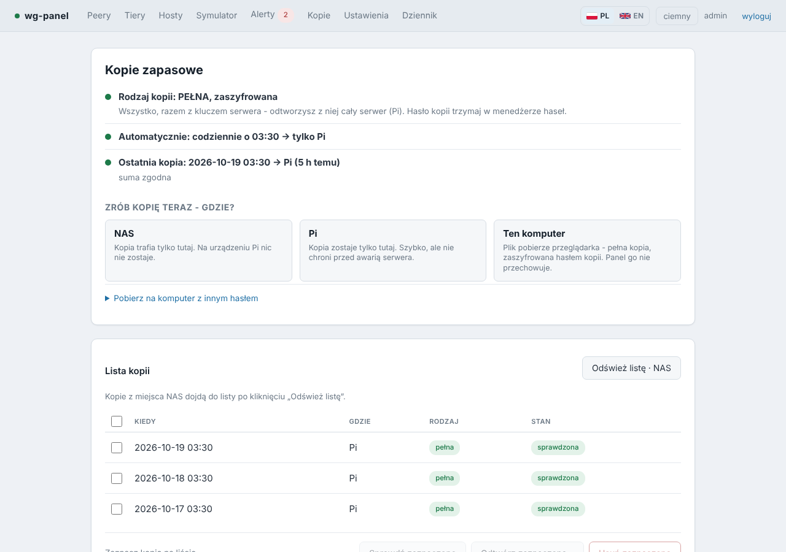
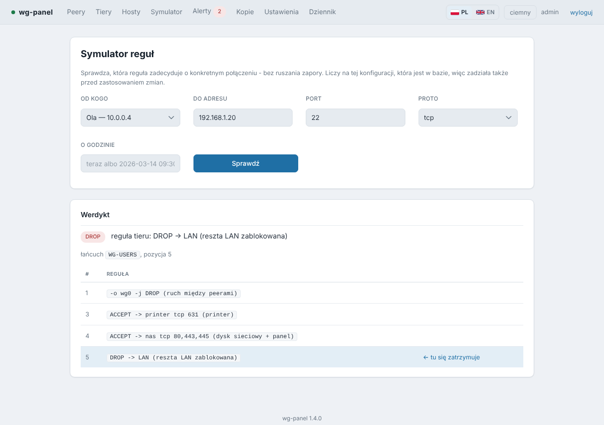
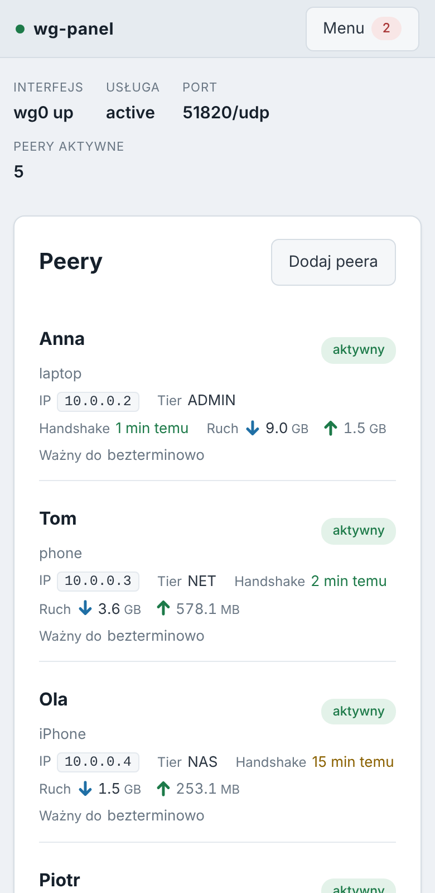

# wg-panel

**Panel WWW i CLI do domowego WireGuarda na Raspberry Pi, zbudowany wokół reguł dostępu, a nie kluczy.**

[English version](README.md)

Większość paneli do WireGuarda zarządza peerami, czyli kluczem i adresem. wg-panel zarządza tym,
do czego w sieci domowej ma dostęp każda osoba. Każdy peer należy do tieru (np. „tylko NAS na
portach 80/443/445”), może mieć własne wyjątki i okno dostępu. Panel zamienia to na `wg0.conf`
i reguły iptables, pokazuje różnicę przed zastosowaniem i sam cofa zmianę, jeśli odcięła Ci dostęp.

- Sam Python 3.9+ ze standardowej biblioteki. Bez pakietów z pip, bez Node, bez budowania, bez CDN.
- Korzysta z `wg` i `iptables`, które i tak są na Pi. Kody QR generuje w czystym Pythonie.
- Proces WWW nigdy nie działa jako root. Root ma tylko mały helper, który przyjmuje zamkniętą listę operacji.
- Interfejs po polsku i po angielsku, ciemny i jasny motyw, działa na telefonie.



<table>
  <tr>
    <td></td>
    <td></td>
  </tr>
  <tr>
    <td></td>
    <td align="center"></td>
  </tr>
</table>

## Co potrafi

| | |
|---|---|
| **Tiery** | Nazwane zestawy reguł. Zmiana tieru przestawia wszystkich przypisanych naraz. Przy pierwszej instalacji powstają trzy: ADMIN (wszystko), NET (tylko internet, LAN zablokowany), NAS (tylko dysk sieciowy). |
| **Reguły osoby** | Host, port, zakres, okno czasowe, ACCEPT albo DROP. Sprawdzane przed regułami tieru, więc wyjątek działa mimo blokady z tieru. |
| **Dostęp do samego Pi** | Osobny łańcuch na `INPUT`: SSH czy RDP do Pi tylko dla wybranych osób. |
| **Okna dostępu** | Bezterminowo, okno od–do albo N dni od pierwszego połączenia. To ostatnie pasuje do gościa, który dostaje kod QR dziś, a połączy się za tydzień. |
| **Katalog hostów** | W regułach piszesz `nas` czy `drukarka` zamiast adresów IP. Adres zmieniasz w jednym miejscu. |
| **Co idzie przez VPN** | `AllowedIPs` w pliku osoby wynika z tego, do czego ma dostęp (cały ruch albo tylko wybrane adresy). |
| **Bezpieczne zastosowanie** | Przed zastosowaniem widzisz różnicę. Bez potwierdzenia w ciągu 90 s zmiana sama się cofa. Przeglądarka potwierdza automatycznie, jeśli nadal dociera do panelu. |
| **Symulator reguł** | „Czy ta osoba dosięgnie tego hosta na tym porcie i która reguła o tym zdecyduje?” Działa jeszcze przed zastosowaniem zmian. |
| **Alerty** | Ten sam klucz z nowego adresu IP, ten sam plik na dwóch urządzeniach naraz, cisza peera, wygaśnięcie, nieudana kopia, konfiguracja zmieniona poza panelem. Przez ntfy, webhook albo e-mail. |
| **Strażnik** | Timer systemd poza procesem panelu sprawdza panel, helpera, `wg0`, temperaturę, miejsce na karcie, napięcie zasilania i certyfikat. Pilnuje terminów dostępu także wtedy, gdy panel nie działa. |
| **Integralność** | Wykrywa ręczną edycję `wg0.conf`, reguły dopisane do łańcuchów panelu, klucze dodane przez `wg set` i reguły wstawione przed łańcuch panelu. |
| **Kopie zapasowe** | Codziennie: na NAS (udział SMB), na Pi albo do pobrania na komputer. Pełna kopia jest zaszyfrowana i zawiera klucz serwera, więc jednym poleceniem odtworzysz z niej całe Pi. |
| **HTTPS** | Własny urząd certyfikacji panelu, ograniczony (X.509 Name Constraints) do sieci domowej, VPN i nazwy Pi. Działa też własny certyfikat, np. z Let's Encrypt. |
| **Własne nazwy urządzeń** | „Pi” i „NAS” to etykiety, które zmienisz w Kopiach (Zmień nazwę); nowa nazwa jest wszędzie, także w alertach, i jedzie razem z kopią. |
| **Historia ruchu** | Wykres godzinowy z 7 dni — każdy dzień w osobnej kolumnie z sumą, dzisiejszy wyróżniony — łączny i dla każdej osoby, z wykrywaniem anomalii. Lista peerów pokazuje ↓ pobrane / ↑ wysłane tak samo, więc liczby zgadzają się z wykresem. |
| **IPv6** | Opcjonalnie. Reguły działają w obu rodzinach adresów. |
| **Linki jednorazowe, kasowanie klucza** | Przekazujesz konfigurację bez wysyłania pliku, potem kasujesz klucz prywatny z serwera. |
| **`wgctl`** | Wszystko, co panel, z terminala. Ta sama baza, ten sam helper. |
| **Dziennik** | Kto, co i kiedy zmienił. Dziennik i alerty mają osobne limity przechowywania (domyślnie 90 dni, 0 = trzymaj wszystko). |

## Wymagania

- Raspberry Pi OS albo Debian 12 (inny system oparty na Debianie z systemd też powinien zadziałać).
- Python 3.9 lub nowszy (jest w Raspberry Pi OS).
- Dostęp do roota. Instalator sam doinstaluje `wireguard-tools`, `iptables` i `smbclient`, jeśli ich brakuje.
- Port UDP przekierowany z routera na Pi (domyślnie 51820) i publiczny adres albo nazwa DDNS.
- `ufw` jest opcjonalny. Jeśli jest, instalator dodaje regułę, która otwiera port panelu tylko na `wg0` (i w LAN-ie, jeśli o to poprosisz).

## Szybki start

Skopiuj projekt na Pi i uruchom instalator:

```bash
git clone https://github.com/mt3ch02/wg-panel.git
cd wg-panel
sudo INSTALL_LANG=pl ./install.sh
```

`INSTALL_LANG=pl` – komunikaty instalatora po polsku (domyślnie są po angielsku). Panel jest od razu dostępny z sieci domowej (domyślnie `LAN_ACCESS=auto`): instalator bierze sieć, w której stoi serwer, i tylko dla niej otwiera port panelu; możesz też podać ją wprost, np. `LAN_ACCESS=192.168.1.0/24`. Zapamiętana sieć, która przestała pasować do serwera (kopia odtworzona na innym komputerze, nowy router), sama zamienia się na sieć serwera. Aktualizacja zachowuje wcześniejszy wybór: panel ustawiony tylko na VPN zostaje tak, dopóki nie uruchomisz `sudo LAN_ACCESS=auto ./install.sh`. Z `LAN_ACCESS=off` panel
słucha tylko na adresie VPN `10.0.0.1` i na samym Pi (wtedy wchodzisz przez
`ssh -L 8080:127.0.0.1:8080 pi@<adres-pi>` i `http://localhost:8080`).

Instrukcja krok po kroku dla wszystkich trzech przypadków — przejęcie istniejącego WireGuarda, czysta instalacja i odtworzenie na nowym Pi — jest w [docs/pl/INSTALACJA.md](docs/pl/INSTALACJA.md).

Co instalator robi na czystym systemie:

1. Pyta o klucz serwera: wklejasz istniejący albo generujesz nowy.
2. Wykrywa sieć domową, adres Pi w LAN-ie i interfejs WAN, podpowiada adres NAS-a.
3. Zakłada konto usługi `wg-panel`, usługi i urząd certyfikacji, dodaje Twoje konto do grupy `wg-panel` (wtedy `wgctl` działa bez `sudo`).
4. Wypisuje adres panelu, odcisk certyfikatu i dalsze kroki.

Potem:

1. Otwórz `https://<adres-pi>:8080` i załóż konto administratora (hasło co najmniej 10 znaków).
   Przeglądarka ostrzega przed certyfikatem, dopóki nie zainstalujesz urzędu panelu. Plik i instrukcja dla iPhone'a, Androida, Windows i macOS są na stronie `/tls`.
2. W **Ustawieniach** wpisz **Endpoint klientów**: nazwę DDNS albo publiczny IP z portem (np. `vpn.example.org:51820`). Sprawdź też wykryte adresy.
3. W **Hostach** sprawdź adres podpowiedziany dla `nas`. Korzysta z niego tier NAS.
4. Dodaj osoby w **Peerach**, potem **Zastosuj zmiany**. Pierwsze zastosowanie podnosi tunel.
5. Przypisz siebie do tieru ADMIN. Przez VPN panel otwierają tylko tiery, które mają jego port w polu **Porty na samym serwerze**; domyślnie tylko ADMIN (`22,3389,8080`).

## Aktualizacja

Pobierz nową wersję i uruchom instalator jeszcze raz:

```bash
cd wg-panel
git pull
sudo ./install.sh
```

Instalator wypisuje zmianę (`Aktualizacja wg-panel: 1.3.2 -> 1.4.0`). Zainstalowaną wersję
widać na dole każdej strony i w `wgctl --version`; co się zmieniło – w
[CHANGELOG.md](CHANGELOG.md).

Aktualizacja podmienia tylko program. Wszystko, co ustawiłeś, zostaje:

- **Dane** (peery, tiery, reguły, hosty, konta, ustawienia, historia) są w `/var/lib/wg-panel/panel.db`, osobno od kodu w `/opt/wg-panel`. Nowe ustawienia dochodzą z wartościami domyślnymi; Twoje wartości nigdy nie są nadpisywane.
- **Opcje instalacji** (`LAN_ACCESS`, `BIND_PORT`, `TLS`, `INSTALL_LANG`) są zapamiętane w `/etc/wg-panel/install.conf`. Nie podajesz ich drugi raz. Żeby którąś zmienić, podaj ją ponownie; `LAN_ACCESS=off` (albo pusta `LAN_ACCESS=`) wyłącza dostęp z LAN. Instalacje sprzed tego pliku odczytują opcje z zainstalowanej usługi i reguły ufw.
- **Kopia bazy** powstaje, zanim ruszy nowy kod. Widać ją w **Kopiach** jako „sprzed aktualizacji” i odtwarzasz ją jak każdą inną.
- **Wbudowane tiery i host `nas`** powstają tylko przy pierwszej instalacji. Jeśli zmieniłeś im nazwy albo je usunąłeś, aktualizacja ich nie przywróci.
- **Klucz serwera, certyfikaty i pliki osób** zostają nietknięte. Nikt nie potrzebuje nowego pliku.

Jeśli po aktualizacji lista peerów pokaże „Panel ma zmiany, których nie ma na interfejsie”,
kliknij **Zastosuj zmiany**. Tak bywa, gdy nowa wersja generuje pliki odrobinę inaczej.

## Przejęcie istniejącego WireGuarda

Jeśli `/etc/wireguard/wg0.conf` już istnieje i nie powstał w panelu, instalator traktuje to
jako przejęcie:

1. Zapisuje obecny stan (`wg0.conf`, `iptables-save`, `ufw status`) w `/root/wg-panel-before/`. To Twoja droga powrotna (`uninstall.sh --restore`).
2. Instaluje panel, nie ruszając działającego tunelu.
3. Importujesz osoby, najpierw na próbę:

```bash
cd /opt/wg-panel
sudo cat /etc/wireguard/wg0.conf | sudo -u wg-panel \
     WGPANEL_DB=/var/lib/wg-panel/panel.db python3 -m panel.import_conf - --tier NAS --dry-run
# wygląda dobrze? uruchom ponownie bez --dry-run
```

4. W panelu nadajesz osobom nazwy i tiery, sprawdzasz je w **Symulatorze**, oglądasz różnicę i klikasz **Zastosuj zmiany**.

Pierwsze zastosowanie nadpisuje `wg0.conf` wersją generowaną. Zaimportowane osoby łączą się dalej
swoimi plikami. Panel nie ma ich kluczy prywatnych (`wg0.conf` ich nie zawiera), więc nowy plik
dla kogoś wydajesz przez **rotację kluczy**.

## Odtworzenie na nowym Pi

Jeśli masz **pełną** kopię, czysty system staje się starym Pi po jednym poleceniu:

```bash
sudo INSTALL_LANG=pl ./install.sh --restore                 # kopia na NAS-ie
sudo INSTALL_LANG=pl ./install.sh --restore ~/kopia.json.enc   # albo plik kopii (pendrive, komputer)
```

Instalator pyta o udział na NAS-ie (chyba że podasz plik) i hasło kopii, sprawdza sumę kontrolną,
odtwarza klucz serwera, urząd certyfikacji, bazę i opcje instalacji (dostęp z LAN, port, HTTPS,
język), po czym podnosi tunel. Wszyscy łączą się dalej swoimi plikami, a urządzenia nadal ufają
certyfikatowi panelu. Zanim cokolwiek zmieni, ostrzega, gdy nowe Pi ma inną nazwę albo adres niż stare.

Co jakiś czas sprawdź, czy hasło kopii dalej ją otwiera — nic się nie zmienia:

```bash
sudo ./install.sh --restore --check
```

### Próbne odtworzenie na drugiej maszynie (serwer testowy)

Żeby sprawdzić, że odtworzenie naprawdę działa, bez ruszania działającego serwera, odtwórz kopię
na zapasowej maszynie (drugie Pi, maszyna wirtualna) w trybie testowym:

```bash
sudo ./install.sh --restore --test              # albo: --restore --test ~/kopia.json.enc
```

To zwykłe odtworzenie, ale kopia zachowuje się jak serwer testowy: automatyczne kopie
i powiadomienia są wyłączone (nie nadpisze prawdziwych kopii na NAS-ie ani nie wyśle alertów),
pliki, kody QR i linki jednorazowe nie są wydawane (kopia ma ten sam klucz serwera, więc
urządzenie z plikiem z niej kłóciłoby się z prawdziwym serwerem), każda strona ma czerwony pasek
**Serwer testowy**, a nazwa serwera dostaje „(test)". Ręczna kopia pyta najpierw o potwierdzenie.

Po teście odinstaluj panel albo – jeśli ta maszyna ma zostać właściwym serwerem – kliknij
**To jest teraz właściwy serwer** na czerwonym pasku (albo `wgctl test off`). `wgctl test
status` pokazuje tryb.

Przy kopii podstawowej (bez klucza serwera) instalator pyta, czy wkleić stary klucz, czy
wygenerować nowy. Z nowym kluczem każda osoba potrzebuje nowego pliku.

## Opcje instalacji

Podajesz je jako zmienne środowiskowe przy pierwszej instalacji. Aktualizacje korzystają z zapamiętanych.

| Opcja | Domyślnie | Znaczenie |
|---|---|---|
| `LAN_ACCESS` | `auto` | Sieć, z której poza VPN wolno otworzyć panel: `auto` (sieć serwera), np. `192.168.1.0/24`, albo `off` (tylko VPN i tunel SSH). |
| `BIND_PORT` | `8080` | Port panelu (HTTPS i HTTP na jednym porcie; zwykłe HTTP z sieci jest przekierowywane). |
| `TLS` | `1` | `0` wyłącza HTTPS. |
| `INSTALL_LANG` | `en` | `pl` – komunikaty instalatora po polsku. |
| `SERVER_KEY` | pytanie | `paste` (klucz na standardowym wejściu) albo `new`, do instalacji bez terminala. |

## Kopie zapasowe

Strona **Kopie** ma trzy części: aktualny stan, **Zrób kopię teraz – gdzie?** (NAS / to Pi /
ten komputer) i jedną listę wszystkich kopii z akcjami na zaznaczonych (sprawdź sumę, odtwórz,
usuń). Ustawienia są na dole.

| | Podstawowa (bez hasła kopii) | Pełna (z hasłem, zaszyfrowana) |
|---|---|---|
| Ustawienia, tiery, peery, reguły, hosty, konta | ✓ | ✓ |
| Hasła do NAS-a, ntfy i e-maila | | ✓ |
| Historia: ruch, handshake'i, dziennik, alerty | | ✓ |
| Klucz prywatny serwera i urząd certyfikacji HTTPS | | ✓ |

- **Miejsce kopii** wybierasz sam: tylko NAS (plik jest na Pi tylko na czas wysyłki), tylko Pi albo oba.
- **Sumy kontrolne.** Każda kopia ma SHA-256 w bazie i w pliku `.sha256`. Zaraz po zapisie panel pobiera kopię z miejsca, w którym faktycznie leży, i ją sprawdza; każda kopia dobowa sprawdza też trzy poprzednie.
- **Szyfrowanie:** scrypt → ChaCha20 (RFC 8439) + HMAC-SHA256, w standardowej bibliotece, sprawdzone wektorami testowymi z RFC. Hasło kopii trzymaj w menedżerze haseł.
- **Panel nie odpytuje NAS-a w tle.** O listę pyta NAS tylko po kliknięciu **Odśwież listę · NAS**, więc uśpiony NAS śpi dalej.
- Kopia podstawowa zawiera klucze współdzielone (PSK) wszystkich osób jawnym tekstem. Panel pokazuje wtedy czerwoną kropkę.

## Model bezpieczeństwa

```
przeglądarka            wgctl (terminal)
   |  HTTPS (wg0, LAN)      |
   v                        v
   +---- SQLite: źródło prawdy ----+
                  |
                  |  gniazdo unix, JSON, zamknięta lista operacji
                  v
       helper/wg_panel_helper.py   (root)
                  |
                  v
  /etc/wireguard/wg0.conf  +  łańcuchy WG-USERS / WG-USERS-HOST
```

- **Panel nigdy nie wysyła poleceń ani gotowej treści plików.** Wysyła model danych. Helper sprawdza go od nowa i sam buduje pliki, więc przejęty proces WWW nie zmusi helpera do niczego, czego helper nie przewiduje.
- **Klucz prywatny serwera nigdy nie trafia do bazy ani do panelu.** Helper czyta go z dysku przy generowaniu plików.
- **Nigdy nie wystawiaj panelu do internetu.** Panel słucha na adresie VPN (i w LAN-ie, jeśli tak wybierzesz). Z VPN otworzą go tylko tiery, które mają jego port w polu **Porty na samym serwerze**.
- **Bez niezależnego audytu bezpieczeństwa.** Projekt ma obronę warstwową, ale nikt spoza niego go nie sprawdzał. Nie wystawiaj panelu do internetu i rób kopie, o które prosi instrukcja.
- Logowanie ma limit (5 prób na 5 minut z jednego adresu). Hasła są chronione przez scrypt, kod z aplikacji (TOTP) jest opcjonalny. Każdy POST ma token CSRF. Ciasteczka są HttpOnly i SameSite=Strict, a jednostki systemd utwardzone.

Zgłaszanie podatności: [SECURITY.md](SECURITY.md).

## Wiersz poleceń

```bash
wgctl status                                   # stan tunelu, niezastosowane zmiany
wgctl list                                     # osoby z handshakiem i terminem ważności
wgctl add Anna --tier NAS --device laptop
wgctl add Gosc --tier NET --days 7             # 7 dni od pierwszego połączenia
wgctl qr Anna                                  # kod QR w terminalu
wgctl rule add Anna --accept drukarka --proto tcp --port 631
wgctl check Anna 192.168.1.10 445 -v           # symulacja; kod 0 = ACCEPT, 2 = DROP
wgctl diff && wgctl apply                      # potem: wgctl confirm
wgctl backup --target smb                      # smb / local / both
wgctl --version                                # zainstalowana wersja
```

Pełna lista: `wgctl --help`.

## Odinstalowanie

```bash
sudo /opt/wg-panel/uninstall.sh            # usuwa panel; VPN działa dalej, dane zostają
sudo /opt/wg-panel/uninstall.sh --purge    # usuwa też dane, konto usługi i zapamiętane opcje
sudo /opt/wg-panel/uninstall.sh --restore  # --purge i powrót do konfiguracji sprzed panelu
sudo /opt/wg-panel/uninstall.sh --wireguard  # --purge i cały WireGuard (tunele, klucz serwera, pakiety)
```

Bez opcji skrypt pyta, który poziom wybrać. Klucz serwera i usługę `wg-quick@wg0` rusza tylko `--wireguard` — pyta wtedy o osobną frazę (`usuń wireguard`). Kopii na NAS-ie skrypt nigdy nie rusza.

## Języki i ograniczenia

- Interfejs WWW jest w całości po polsku i po angielsku. Wybór zapamiętuje przeglądarka.
- Treść powiadomień (ntfy, e-mail) i komunikaty `wgctl` są po polsku. Dokumentacja jest po polsku i po angielsku.
- Panel obsługuje jeden interfejs WireGuarda (`wg0`) na jednym Pi, dla domu albo małego biura.

## Rozwój

Nie ma kroku budowania. Każdy plik testów zakłada własną tymczasową bazę i podmienia `wg`,
`iptables` oraz `systemctl` na atrapy, więc testy nie ruszają sieci:

```bash
for t in tests/selftest.py tests/test_*.py; do python3 "$t" || break; done
```

`tests/test_permissions.py` wymaga roota (przełącza się na inne numery kont), bez niego się pomija.
Jak panel działa w środku (kolejność reguł, bezpiecznik, integralność, HTTPS, kopie, każdy moduł),
opisuje [docs/pl/ARCHITEKTURA.md](docs/pl/ARCHITEKTURA.md) ([in English](docs/en/ARCHITECTURE.md)).

```
panel/        aplikacja WWW (serwer HTTP, widoki, reguły, kopie, harmonogram)
helper/       jedyny komponent z rootem
wgctl         wiersz poleceń
systemd/      jednostki usług i timer strażnika
install.sh    instalacja, aktualizacja i --restore
uninstall.sh  cztery poziomy usuwania
tests/        testy (nie trafiają na Pi)
docs/         instrukcje i dokumentacja techniczna (pl, en), zrzuty ekranu
```

## Licencja

[MIT](LICENSE)
