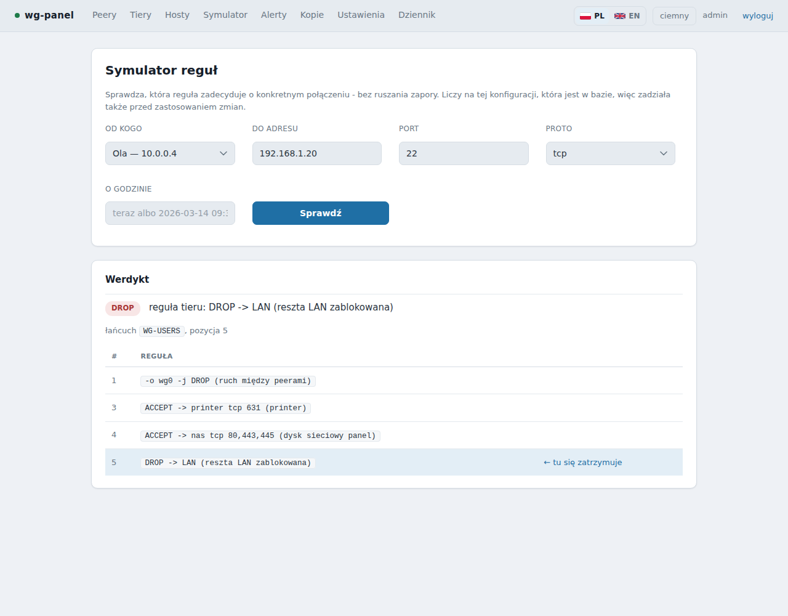
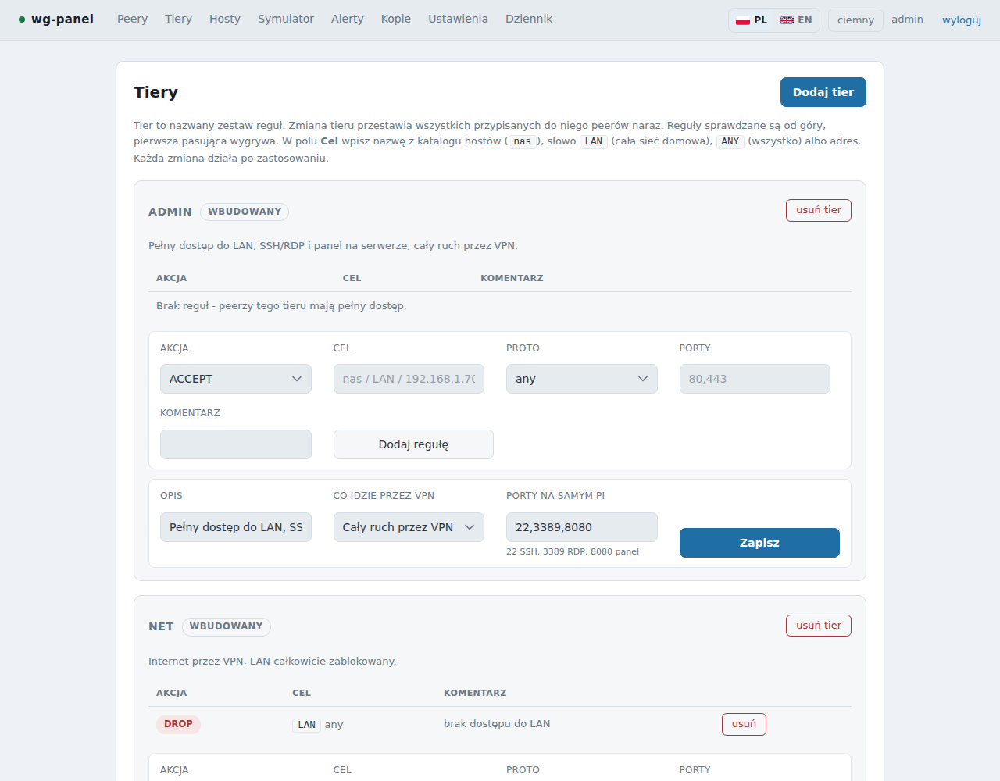

# wg-panel

**[English → README.md](README.md)**

Panel webowy **i CLI** do WireGuarda, w którym **polityka dostępu jest obywatelem pierwszej kategorii**. Gotowe rozwiązania modelują peera — klucz i adres. Tutaj peer to nośnik; sensem jest to, co widzi w Twoim LAN-ie, a to są reguły iptables generowane razem z konfiguracją.

Zrobiony pod domową sieć albo małe biuro na Raspberry Pi: kilka osób, jeden NAS, parę urządzeń — i chcesz, żeby „Marek otworzy NAS i nic więcej” naprawdę było prawdą, i to dającą się sprawdzić.


- **Zero zależności z pip.** Sam Python 3.9+ ze standardowej biblioteki.
- **Bez kroku budowania.** Brak Node, bundlera i CDN-ów.
- Korzysta z `wg` i `iptables`, które i tak są na maszynie. Kody QR rysuje sam, w czystym Pythonie.
- Panel po **polsku i angielsku** (język wybiera się według przeglądarki, można przełączyć); instalator też.

> ⚠ **Przeczytaj przed użyciem.** wg-panel zapisuje reguły firewalla i `wg0.conf`, a część programu działa jako root. Ma zaprojektowaną obronę warstwową (patrz [Bezpieczeństwo](#bezpieczeństwo)), ale **nie przeszedł niezależnego audytu bezpieczeństwa**. Nie wystawiaj go do internetu, idź za [instrukcją](docs/pl/INSTALACJA.md) i rób kopie, o które prosi.

## Co potrafi

| | |
|---|---|
| **Tiery** | nazwany zestaw reguł; zmiana tieru przestawia wszystkich przypisanych naraz |
| **Reguły per osoba** | host, port, zakres, okno czasowe (`-m time`), ACCEPT/DROP; sprawdzane przed regułami tieru |
| **Symulator reguł** | „czy ten peer dosięgnie tego hosta na tym porcie i która reguła zdecyduje” — zanim cokolwiek zastosujesz |
| **Bezpiecznik** | zastosowanie z automatycznym cofnięciem, jeśli nie potwierdzisz — reguła, która Cię odcina, sama się naprawia |
| **Podgląd zmian** | widzisz, co się zmieni, zanim to zastosujesz |
| **Okna dostępu** | bezterminowo, okno od–do albo N dni od pierwszego użycia; działa też, gdy panel leży |
| **Katalog hostów** | `nas`, `drukarka` zamiast adresów w regułach; zmiana IP w jednym miejscu |
| **Split tunnel albo cały ruch** | per tier lub osoba: cały ruch, tylko to, do czego ma dostęp, cały LAN, własna lista |
| **Dostęp do serwera** | SSH/RDP na Pi tylko dla wskazanych osób, w osobnym łańcuchu |
| **Kopie zapasowe** | codziennie, lokalnie albo na NAS przez SMB; sumy SHA-256 sprawdzane przez ponowne pobranie; opcjonalne szyfrowanie ChaCha20 + HMAC |
| **Alerty** | nowy adres znanego klucza (wyciek pliku?), ten sam plik używany na dwóch urządzeniach naraz (częsta przyczyna „VPN co chwilę się rozłącza”), cisza peera, wygaśnięcie, nieudana kopia — ntfy, webhook, e-mail |
| **Strażnik** | niezależny timer systemd: panel, helper, `wg0`, temperatura Pi, zasilanie, dysk, certyfikat |
| **Kontrola integralności** | wykrywa zmiany konfiguracji zrobione poza panelem |
| **Historia ruchu** | wykres z 7 dni i wykrywanie anomalii |
| **HTTPS** | własny urząd certyfikacji z ograniczeniem nazw (albo Twój certyfikat); działa za reverse proxy |
| **Linki jednorazowe, kasowanie klucza** | wydajesz konfigurację bez trzymania klucza prywatnego na serwerze |
| **IPv6** | opcjonalnie; reguły generowane dla obu rodzin |
| **Telefon** | działa od 320 px; domyślnie ciemny motyw |
| **`wgctl`** | wszystko, co robi panel, z terminala |

<p>


</p>

## Wymagania

- Raspberry Pi OS / Debian / Ubuntu z **systemd**, dostęp do roota
- `wireguard` (`wg`, `wg-quick`), `iptables`, Python **3.9+**, `openssl`
- opcjonalnie: `smbclient` (kopie na NAS — instalator sam go doinstaluje), `ufw`
- Pi za routerem z **rezerwacją DHCP** i przekierowanym portem UDP WireGuarda

## Szybki start

```bash
sudo apt install -y git
git clone https://github.com/mt3ch02/wg-panel.git
cd wg-panel
sudo INSTALL_LANG=pl ./install.sh      # komunikaty po polsku (bez INSTALL_LANG: po angielsku)
```

Potem otwórz panel, załóż konto i **sprawdź ustawienia sieci** (podsieć LAN, adres Pi, adres NAS, endpoint) — domyślne wartości zakładają typową sieć domową (`192.168.1.0/24`). [Instrukcja](docs/pl/INSTALACJA.md) opisuje trzy ścieżki:

| Masz | Ścieżka |
|---|---|
| działający serwer WireGuard na Pi | **A** — panel go przejmuje; klienci niczego nie zmieniają |
| czysty system | **B** — nowy klucz serwera, nowy VPN |
| czysty system oraz kopię panelu i klucz serwera | **C** — odtworzenie; nikt niczego nie zmienia |

Opcje instalatora: `LAN_ACCESS=192.168.1.0/24` (panel dostępny z sieci domowej), `BIND_HOST`, `BIND_PORT`, `TLS=0`, `INSTALL_LANG=pl`. Aktualizacja: `git pull && sudo ./install.sh` — dane zostają. Odinstalowanie: `sudo /opt/wg-panel/uninstall.sh` (VPN działa dalej).

## Jak to działa

```
przeglądarka       wgctl (terminal)
   |                    |
   v                    v
   +--- SQLite: źródło prawdy ---+
                |   gniazdo unix, lista dozwolonych operacji
                v
      helper (root)  ->  wg0.conf + łańcuchy WG-USERS / WG-USERS-HOST
```

Proces webowy nie ma roota. Nie wysyła komend — tylko model danych — a mały helper waliduje go od nowa i sam renderuje pliki. Klucz prywatny serwera nigdy nie trafia do bazy. VPN działa, nawet gdy panel leży. Szczegóły: [docs/pl/ARCHITEKTURA.md](docs/pl/ARCHITEKTURA.md).

## Bezpieczeństwo

Rozdział procesów, helper z listą dozwolonych operacji, walidacja po obu stronach, żadnego shella, scrypt + blokada prób + opcjonalny TOTP, tokeny CSRF, ciasteczka `HttpOnly`/`SameSite=Strict`, hardening systemd, szyfrowane kopie i alert, gdy klucz pojawi się z nowego adresu. Pełna tabela oraz to, przed czym panel **nie** chroni (root na Pi, wyniesiona karta SD), jest w dokumencie o architekturze. Zgłoszenie podatności: [SECURITY.md](SECURITY.md).


## Znane ograniczenia

- Ustawienia domyślne zakładają typową sieć domową (LAN `192.168.1.0/24`, NAS `192.168.1.11`, Pi `192.168.1.10`, port WireGuarda `51820`). Sprawdź je w Ustawieniach przed pierwszym zastosowaniem.
- `wgctl`, treść powiadomień i komentarze w kodzie są na razie **po polsku**. Panel i instalator są dwujęzyczne. Tłumaczenia i PR-y mile widziane.
- Testowane tylko na Raspberry Pi OS (Debian).

## Dokumentacja

| | English | Polski |
|---|---|---|
| Instalacja i obsługa | [docs/en/INSTALL.md](docs/en/INSTALL.md) | [docs/pl/INSTALACJA.md](docs/pl/INSTALACJA.md) |
| Architektura | [docs/en/ARCHITECTURE.md](docs/en/ARCHITECTURE.md) | [docs/pl/ARCHITEKTURA.md](docs/pl/ARCHITEKTURA.md) |

## Licencja

[MIT](LICENSE)
